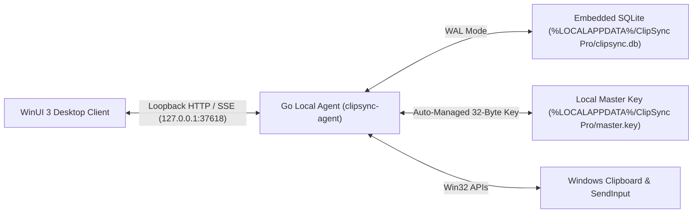

# ClipSync Pro Architecture (Windows Local Edition)

## Goals

ClipSync Pro (Windows Local Edition) is a 100% local, zero-cloud Windows 11/10 clipboard history manager, structured AI Prompt template hub, and AES-256-GCM encrypted credential & 2FA vault. All clipboard records, normalized PNG images, prompt templates, and encrypted sensitive records are stored exclusively on the user's machine in an embedded SQLite database.

## Architecture Style

The system uses a local-only desktop architecture combining a native WinUI 3 desktop client with a lightweight Go background daemon (`clipsync-agent`) over a localhost loopback boundary.

## Runtime Components

- **WinUI 3 Desktop Client (`windows/ClipSyncPro.WinUI`)**: Windows 11 Fluent Acrylic desktop interface providing global `Alt + V` hotkey toggling, top-right workspace docking, four primary views (`全部`, `⭐ 收藏夹`, `💡 提示词库`, `🔒 账户密码`), date (`yyyyMMdd`) and keyword filtering, prompt variable fill & auto-paste, and sensitive credential detail/2FA TOTP display.
- **Go Local Agent (`cmd/clipsync-agent`, `internal/agent`)**: Background daemon responsible for Win32 clipboard sequence监听, guarded clipboard writes (`clipboardWriteGuard`), focus restoration + `SendInput` (`Ctrl + V`) injection, local REST/SSE endpoints, and in-memory 30-minute reveal caching.
- **Embedded SQLite Store (`internal/storage/sqlite.go`)**: Pure-Go embedded SQLite storage (`modernc.org/sqlite`) configured with `journal_mode=WAL`, `busy_timeout=5000`, and `synchronous=NORMAL`, requiring zero external database services.
- **Local Security Engine (`internal/security`)**: Exclusive atomic creation and loading of `master.key`, PBKDF2-HMAC-SHA256 + AES-256-GCM authenticated encryption, and keyed HMAC-SHA256 blind indexing for encrypted keyword search.

## Deployment & Data Isolation

- **Zero External Dependencies**: No MySQL server, no cloud sync server, and no manual environment setup required.
- **Strict Separation of Code and Runtime Data**: All user data (`clipsync.db`, `master.key`, `agent.log`, `crash.log`) is stored under `%LOCALAPPDATA%\ClipSync Pro` (or custom `CLIPSYNC_DATA_DIR`), completely isolated from the application binary directory.
- **Clean Release Guarantee**: Build and release pipelines strictly exclude `.db`, `.sqlite`, `.key`, `.log`, and `.pdb` files.

## Security Model

- Sensitive fields (`content_cipher`, `account_cipher`, `password_cipher`, `remark_cipher`, `two_factor_cipher`) are encrypted with **AES-256-GCM** using keys derived via **PBKDF2-HMAC-SHA256** (120,000 iterations, random per-field salt and 12-byte nonce).
- Key material is automatically provisioned on first launch in `%LOCALAPPDATA%\ClipSync Pro\master.key` (32 cryptographically random bytes encoded as 64 hex characters with `0600` permissions) or supplied via `CLIPSYNC_SECRET`.
- Encrypted records remain searchable by keyword via **HMAC-SHA256 blind index** token hashes stored in `search_index`.
- Sensitive plaintext is never written to SQLite or application logs; decrypted payloads exist only transiently in memory when explicitly revealed or copied by the user.
